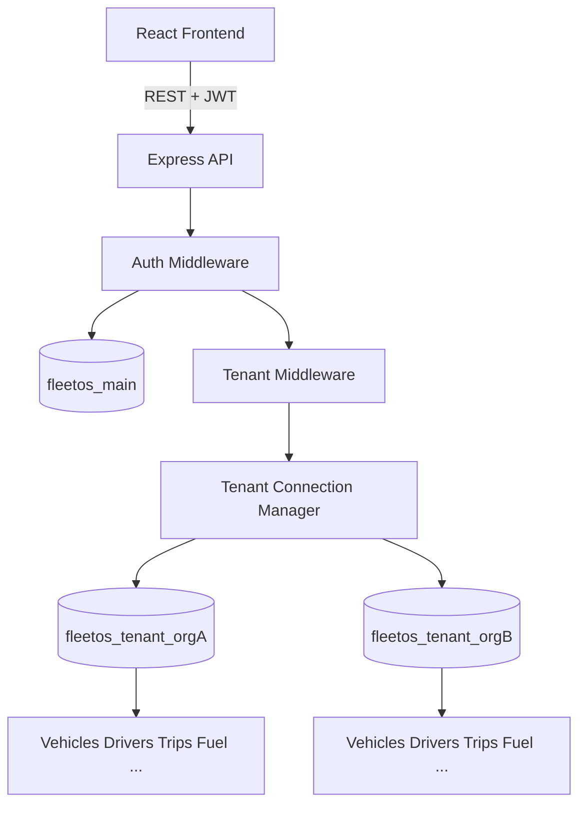

# FleetOS

Multi-tenant Fleet & Vehicle Management SaaS built with the MERN stack (MongoDB, Express, React, Node.js).

Each organization gets its own MongoDB database for fleet data. Platform users, organizations, and authentication live in a shared main database.

---

## Project Overview

FleetOS helps companies manage:

- Vehicles and drivers
- Vehicle documents (RC, Insurance, PUC, etc.)
- Trips
- Fuel, maintenance, and expenses
- Alerts and dashboard analytics
- Users and roles

---

## Features

- JWT authentication with role-based access control (RBAC)
- Strict tenant isolation (per-organization databases)
- Vehicle, driver, trip, fuel, maintenance, expense CRUD
- Vehicle document tracking with expiry status
- Automatic alert generation for expiries and service due
- Dashboard KPIs and Recharts analytics
- Server-side search, filter, sort, and pagination
- Local file uploads for documents (dev)

---

## Tech Stack

| Layer | Stack |
|-------|--------|
| Frontend | React, TypeScript, Vite, React Router, TanStack Query, Axios, Tailwind CSS, React Hook Form, Zod, Recharts, Lucide |
| Backend | Node.js, Express, TypeScript, Mongoose, JWT, bcrypt, Zod, Helmet, CORS, rate limiting |
| Database | MongoDB (main + per-tenant databases) |

---

## Architecture

```text
User
 ↓
Main Database (fleetos_main)
 ↓
Organization
 ↓
Tenant Database (fleetos_tenant_<orgId>)
 ↓
Fleet Data (vehicles, drivers, trips, ...)
```

### Request flow

```text
Login
 ↓
User found in Main DB
 ↓
User belongs to Organization A
 ↓
JWT contains userId + organizationId + role
 ↓
Authenticated request
 ↓
Tenant connection resolved from JWT organizationId (never from client body)
 ↓
Query runs against Organization A's tenant DB
```

### Mermaid diagram



---

## Database Architecture

### Main database (`fleetos_main`)

Stores platform-level data only:

- Users
- Organizations
- UserOrganization relationships

### Tenant databases (`fleetos_tenant_<organizationId>`)

Each organization has a dedicated database with:

- vehicles
- drivers
- vehicleDocuments
- trips
- fuelRecords
- maintenanceRecords
- expenses
- alerts
- activities

Tenant connections are cached and reused via `getTenantConnection(organizationId)`.

---

## Multi-Tenant Architecture

**Rule:** Never trust `organizationId` from the frontend for authorization.

The backend always derives the tenant from the authenticated JWT / user record.

---

## Folder Structure

```text
FleetOS/
├── backend/
│   ├── src/
│   │   ├── config/          # env, main DB, tenant DB manager
│   │   ├── controllers/
│   │   ├── middleware/      # auth, tenant, validation, errors
│   │   ├── models/
│   │   │   ├── main/        # User, Organization, UserOrganization
│   │   │   └── tenant/      # Vehicle, Driver, Trip, ...
│   │   ├── routes/
│   │   ├── services/
│   │   ├── validators/
│   │   ├── utils/
│   │   ├── scripts/seed.ts
│   │   ├── app.ts
│   │   └── server.ts
│   ├── uploads/
│   ├── .env.example
│   └── package.json
├── frontend/
│   ├── src/
│   │   ├── components/
│   │   ├── pages/
│   │   ├── services/
│   │   ├── hooks/
│   │   ├── context/
│   │   ├── types/
│   │   ├── routes/
│   │   └── utils/
│   └── package.json
└── README.md
```

---

## Environment Variables

Copy `backend/.env.example` to `backend/.env`:

```env
NODE_ENV=development
PORT=5000
MAIN_MONGODB_URI=mongodb://localhost:27017/fleetos_main
TENANT_MONGODB_BASE_URI=mongodb://localhost:27017
JWT_SECRET=change_this_secret_in_production
JWT_EXPIRES_IN=7d
CLIENT_URL=http://localhost:5173
UPLOAD_DIR=uploads
```

Never commit `.env` or real secrets.

---

## Installation

### Prerequisites

- Node.js 20+
- MongoDB running locally (default port `27017`)

### Install dependencies

```bash
cd backend
npm install

cd ../frontend
npm install
```

---

## Database Setup

1. Start MongoDB locally.
2. The app creates `fleetos_main` on first connection.
3. Tenant databases are created when an organization is used / seeded.

---

## Seed Data

```bash
cd backend
npm run seed
```

Creates:

- 1 organization
- 5 users
- 20 vehicles
- 10 drivers
- 30 trips
- 50 fuel records
- 30 maintenance records
- ~70 expenses
- 20 alerts

### Demo login

```text
Email:    admin@fleetos.com
Password: Oneplus@123
```

Other seeded users (same password):

| Email | Role |
|-------|------|
| admin@fleetos.com | ADMIN |
| manager@fleetos.com | FLEET_MANAGER |
| accounts@fleetos.com | ACCOUNTANT |
| driver@fleetos.com | DRIVER |
| viewer@fleetos.com | VIEWER |

---

## Running Locally

Terminal 1 — API:

```bash
cd backend
npm run dev
```

API: http://localhost:5000  
Health: http://localhost:5000/api/health

Terminal 2 — UI:

```bash
cd frontend
npm run dev
```

UI: http://localhost:5173

---

## Authentication

1. `POST /api/auth/login` with email/password
2. Server validates against main DB, resolves organization, returns JWT
3. Client stores token and sends `Authorization: Bearer <token>`
4. Protected routes use `authenticate` + `resolveTenant` middleware

JWT payload (minimal):

```json
{
  "userId": "...",
  "organizationId": "...",
  "role": "FLEET_MANAGER"
}
```

### Roles

`SUPER_ADMIN` · `ADMIN` · `FLEET_MANAGER` · `ACCOUNTANT` · `DRIVER` · `VIEWER`

---

## API Documentation

Base URL: `http://localhost:5000/api`

| Method | Endpoint | Description |
|--------|----------|-------------|
| POST | `/auth/login` | Login |
| GET | `/auth/me` | Current user |
| POST | `/auth/logout` | Logout |
| GET/POST | `/vehicles` | List / create |
| GET/PUT/DELETE | `/vehicles/:id` | Read / update / delete |
| PATCH | `/vehicles/:id/assign-driver` | Assign driver |
| GET/POST | `/drivers` | List / create |
| GET/PUT/DELETE | `/drivers/:id` | Read / update / delete |
| GET/POST | `/trips` | List / create |
| GET/PUT/DELETE | `/trips/:id` | Read / update / delete |
| GET/POST | `/fuel` | List / create |
| GET | `/fuel/summary` | Fuel summary |
| GET/POST | `/maintenance` | List / create |
| GET | `/maintenance/upcoming` | Upcoming service |
| GET/POST | `/expenses` | List / create |
| GET/POST | `/documents` | List / create |
| GET | `/alerts` | List alerts |
| PATCH | `/alerts/:id/read` | Mark read |
| POST | `/alerts/generate` | Scan & generate |
| GET | `/dashboard` | Dashboard metrics |
| GET/PUT | `/organization` | Org profile |
| GET/POST | `/organization/users` | User management |

### Pagination

```text
GET /api/vehicles?page=1&limit=20&search=RJ01&status=ACTIVE
```

Response shape:

```json
{
  "success": true,
  "message": "Success",
  "data": [],
  "pagination": {
    "page": 1,
    "limit": 20,
    "total": 100,
    "totalPages": 5
  }
}
```

### Errors

```json
{
  "success": false,
  "message": "Vehicle not found",
  "code": "VEHICLE_NOT_FOUND"
}
```

---

## Tenant Isolation

- JWT carries the user's organization
- `resolveTenant` opens/reuses that org's DB connection
- Services always use `req.tenantConnection`
- Users cannot query another org's database by sending a different `organizationId`

---

## Production Considerations

- Set a strong `JWT_SECRET`
- Use TLS for MongoDB and HTTPS for the API
- Restrict CORS `CLIENT_URL`
- Serve the Vite build behind nginx / a reverse proxy
- Rotate secrets; never commit `.env`
- Consider backup strategies for main + each tenant database
- Rate limiting is enabled on login; extend as needed
- Local `uploads/` is for development — replace with durable storage later if required (not AWS-specific)

---

## Scripts

### Backend

```bash
npm run dev      # start API with hot reload
npm run build    # compile TypeScript
npm run start    # run compiled dist
npm run seed     # seed demo data
```

### Frontend

```bash
npm run dev      # Vite dev server
npm run build    # production build
npm run preview  # preview build
```

---

## License

MIT
